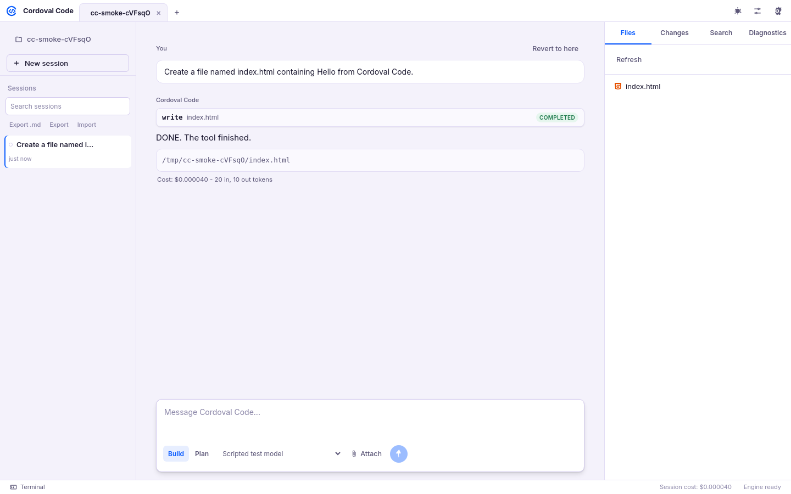
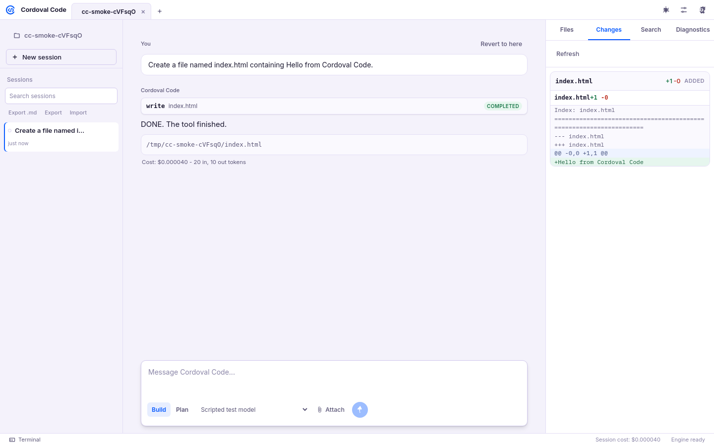
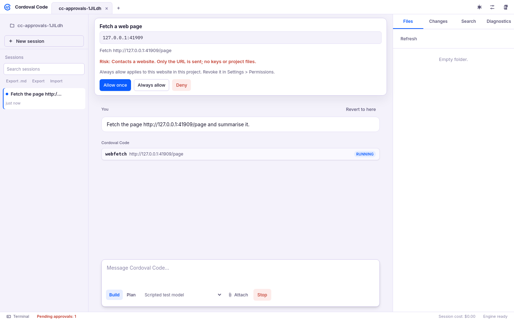
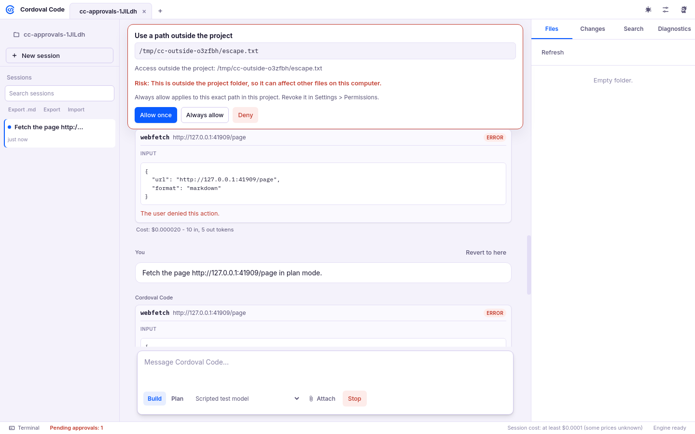
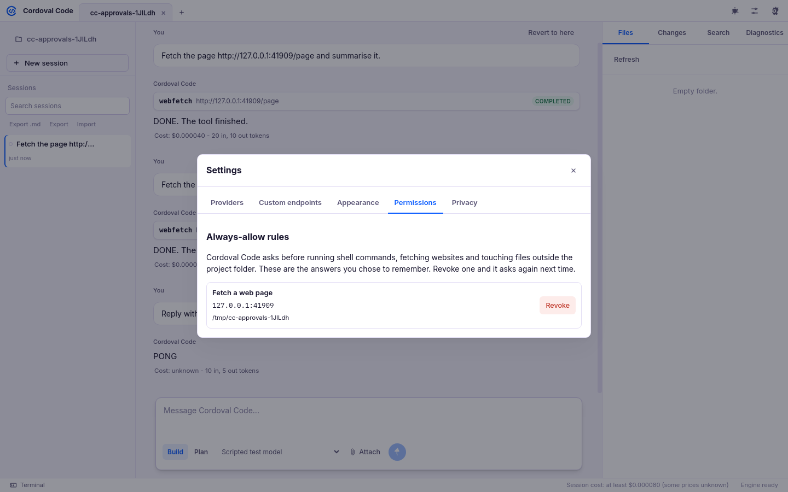
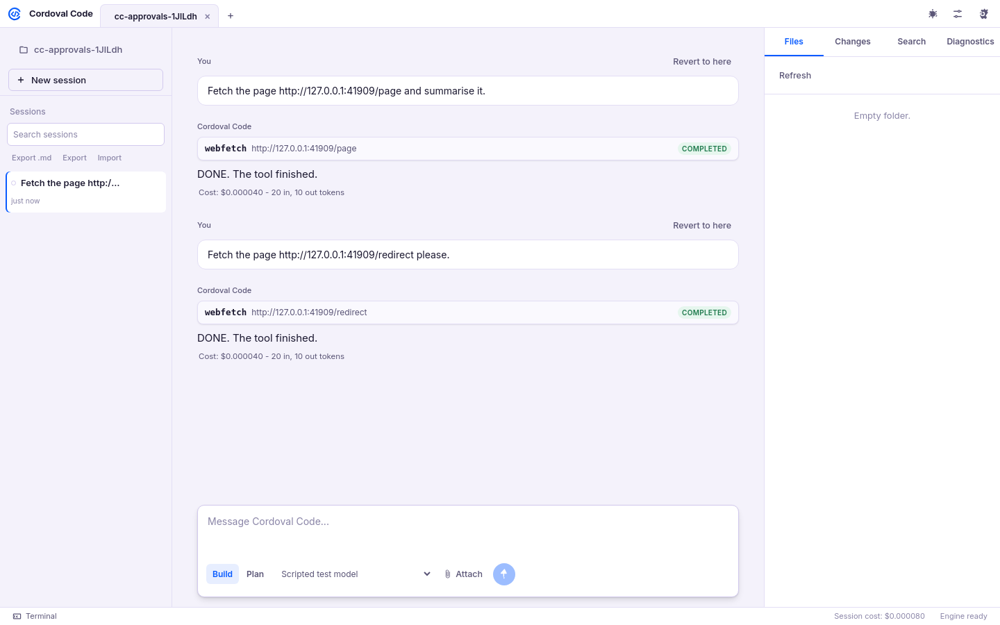

# Cordoval Code

Privacy-first desktop AI coding app from Cordoval. Bring your own key, no Cordoval servers, no telemetry.

## How it works
- Electron shell (`src/main`) with a plain-JS UI (`src/renderer`).
- The Cordoval engine (`src/main/engine/`) runs inside the app's main process and serves a local
  HTTP + server-sent-events API on `127.0.0.1` (random port, per-run token). It provides sessions,
  streaming chat with tool calls (Vercel AI SDK), tools (read, write, edit, list, glob, grep, shell
  with approval), Build and Plan agents, custom agents and commands, MCP servers, snapshots for
  undo/revert with diffs, file and git APIs, and PTY terminals (node-pty).
- Sessions, messages and snapshots live in the app's own user-data folder (`engine/`).
  There is no sharing, no telemetry and no auto-update.

## Features
Folder picker and recent projects, sessions sidebar (multi-session), streaming chat with tool cards,
permission prompts (allow once / always / deny), revert to any message and restore, Build/Plan mode,
model picker per session (models listed from each provider's API), file tree and viewer, changes with
unified diffs, grep search, terminal panel (xterm.js), light lavender and dark themes, and project
templates (React+Vite, Next.js, static site, Electron, Tauri, Android Kotlin Compose, React Native
Expo, Flutter, Node API, FastAPI) with builder system prompts.

- Built-in Monaco editor (tabs, save, syntax highlighting, inline diagnostics from local language servers).
- File and image attachments (button, drag and drop, paste).
- Slash commands: /new, /plan, /build, /undo, /redo, /model, /init, /compact, /clear, /theme, /terminal, /settings, /help, plus project commands.
- Customise panel (Ctrl+;): MCP servers (local stdio and remote HTTP, enable/disable, connect, tool lists), custom agents and slash commands (global config or project `.cordoval/`; `.opencode/` folders are read too), and per-tool permissions with shell command rules. All changes apply live.
- Custom primary agents appear next to Build and Plan.
- Command palette (Ctrl+K or Ctrl+Shift+P), Go to file (Ctrl+P), and a shortcuts panel (Ctrl+/).
- 37 colour themes: Cordoval lavender (default) plus more, each in light and dark.
- Session history: search across sessions, rename, delete, export to Markdown, export and import JSON.
- @-mentions for files, folders and agents, with autocomplete. Mentioned files are sent as context.
- Per-line review comments on the Changes diff, sent to the agent in one message.
- Project tabs in the title bar (Ctrl+T, Ctrl+W, Ctrl+Tab) and rebindable shortcuts.
- First-run permissions ask before sudo, rm -rf, git push, npm publish and curl | sh.

## Approvals and safety

- Shell commands, web fetches and any path outside the project folder ask first. The card shows the exact command, URL or path and a plain-English risk note for sudo, rm -rf, git push, publish, curl|sh and outside-project access.
- Choose Allow once, Always allow or Deny. "Always allow" covers that exact command, website or path in that project; review and revoke these in Settings > Permissions.
- A "Pending approvals" counter in the status bar shows when any session is waiting on you.
- Plan mode is read-only and cannot fetch websites unless you allow it for the plan agent in config.

## Web fetch, cost and subagents

- `webfetch` turns a public page into markdown or text (5 MB and 120 s limits). Requests carry no keys or cookies and cannot reach this computer or a private network.
- Each reply shows its cost from token usage: OpenRouter prices come from its model list, direct providers use a small built-in table (`src/main/engine/providers.js`). If the price is not known it says "unknown", never $0.
- The `task` tool starts a research subagent in a hidden sub-session with read-only tools (read, list, glob, grep). Its approvals appear in the parent chat.

## Screenshots

| | |
|---|---|
|  |  |
|  |  |
|  |  |

## Keys (bring your own)
Settings > Providers: OpenRouter (default; key or "Sign in with OpenRouter" PKCE), OpenAI, Anthropic,
Google Gemini, Groq, xAI, plus any OpenAI-compatible endpoint, Ollama and LM Studio presets.
Keys are encrypted with Electron safeStorage (Windows DPAPI, Linux Secret Service/kwallet). The
engine adds a key only as a request header inside its HTTP client, and only for that provider's host.
Keys never go into prompts, messages, tool output, logs, session files or the window; the engine
also scrubs any known key from everything it stores or streams. `test/keys-never-leak.js` checks this.

## Develop
    npm install
    npm start
    npm test                       # headless suite (xvfb-run) with the scripted test provider
    LIVE=1 OPENROUTER_TEST_KEY=... npm test   # adds one live OpenRouter run

## Build
    npm run dist:linux   # dist/Cordoval Code-<ver>.AppImage
    npm run dist:win     # dist/Cordoval Code Setup <ver>.exe (NSIS)
Cross-building the Windows installer on Linux needs wine. On Windows natively: install Node 20 and
Git, then `npm install` and `npm run dist:win`. Code signing is not configured yet.

## Licence
MIT. Some UI assets are MIT-licensed third-party work - see NOTICE.md.

## Tests
Under `test/` (Playwright + Xvfb, `CORDOVAL_MOCK_PROVIDER=1` scripted model): smoke, e2e, editor,
composer, slash, deny, sudo-ask, history, review, mentions, customize, keys-never-leak, and
live-openrouter (needs a key). Run them all with `npm test`.
