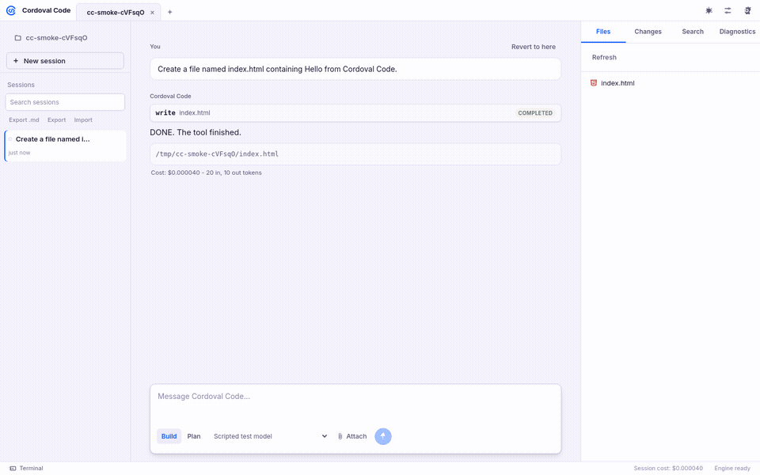

# Cordoval Code

**An open-source AI coding desktop app with its own engine: bring your own key, approve what runs, undo anything.**

Website: [code.cordoval.co.uk](https://code.cordoval.co.uk)

## Why it's different

- **Its own engine.** Chat, file edits, terminal commands and undo run inside the app on `127.0.0.1`. There are no Cordoval servers in the loop.
- **Bring your own key.** Your key goes only to that provider's own host, as a request header. It never appears in prompts, logs, session files or the window.
- **You stay in control.** Shell commands, web fetches and writes outside the project ask first. Risky commands always ask, with a plain-English risk note.
- **No telemetry, no auto-update, no account.** Sessions live in the app's own user-data folder.
- **Honest costs.** Every reply shows what it cost. If a price is unknown it says "unknown", never $0.

## Features

- Streaming chat with tool cards: read, write, edit, list, glob, grep and shell.
- Snapshots for every change, with unified diffs. Revert to any message and restore.
- Build and Plan modes (Plan is read-only), plus custom agents and slash commands.
- Read-only research subagent (`task` tool) for exploring a codebase without touching it.
- Web fetch that turns a public page into markdown, asking per site.
- Cost counter per reply.
- Built-in Monaco editor, file tree, Changes view with per-line review comments, grep search and an xterm.js terminal.
- MCP servers (local stdio and remote HTTP).
- Customise panel (Ctrl+;): MCP servers (local stdio and remote HTTP, enable/disable, connect, tool lists), custom agents and slash commands (global config or project `.cordoval/`; `.opencode/` folders are read too), and per-tool permissions with shell command rules. All changes apply live.
- @-mentions for files, folders and agents; file and image attachments.
- Command palette, project tabs, rebindable shortcuts and 37 colour themes in light and dark.
- Project templates: React+Vite, Next.js, static site, Electron, Tauri, Android Kotlin Compose, React Native Expo, Flutter, Node API and FastAPI.
- Session history: search, rename, export to Markdown, export and import JSON.

## Quick start

Cordoval Code runs from source on Windows and Linux. There is no installer yet. You need [Node.js 20](https://nodejs.org) and [Git](https://git-scm.com).

1. Get the source:

       git clone https://github.com/Gitkierenoffical/Cordoval-Code.git
       cd Cordoval-Code

2. Install dependencies:

       npm install

3. Start the app:

       npm start

Then open Settings > Providers, add a key, pick a project folder and start chatting.

## Supported providers

| Provider | Notes |
|---|---|
| OpenRouter | Default. Paste a key or use "Sign in with OpenRouter" (PKCE). |
| OpenAI | API key |
| Anthropic | API key |
| Google Gemini | API key |
| Groq | API key |
| xAI | API key |
| Any OpenAI-compatible endpoint | Custom base URL; Ollama and LM Studio presets included |

Models are listed from each provider's own API.

## Security and approvals

- **Approvals.** Shell commands, web fetches and any path outside the project folder show an approval card with the exact command, URL or path. Choose **Allow once**, **Always allow** or **Deny**.
- **Risky commands always ask.** `sudo`, `rm -rf`, `git push`, `npm publish`, `curl | sh` and outside-project access come with a risk note.
- **Web fetch asks per site.** Requests carry no keys or cookies and cannot reach this computer or a private network.
- **Review and revoke.** "Always allow" rules are scoped to that command, site or path in that project, and listed in Settings > Permissions.
- **Keys.** Encrypted with Electron safeStorage (Windows DPAPI, Linux Secret Service or kwallet) and sent only to the matching provider host. The engine also scrubs known keys from everything it stores or streams; `test/keys-never-leak.js` checks this.
- **Undo.** Every file change is snapshotted, so you can revert to any point in a session.

## Screenshots

| | |
|---|---|
|  |  |
|  |  |
|  |  |

## Develop

    npm install
    npm start
    npm test      # headless suite (xvfb-run) with a scripted test provider

## Contributing

Contributions are welcome. Read [CONTRIBUTING.md](CONTRIBUTING.md) and our [Code of Conduct](CODE_OF_CONDUCT.md), then open an issue or pull request. Questions: management@cordoval.co.uk.

## License

[MIT](LICENSE). Some UI assets are MIT-licensed third-party work; see [NOTICE.md](NOTICE.md).

Website: [code.cordoval.co.uk](https://code.cordoval.co.uk)
